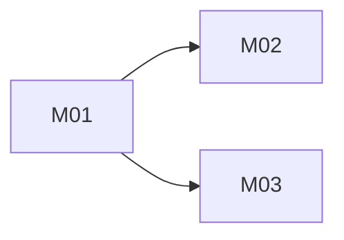

# Greenfield Build Plan Template

````markdown
# <Product> Build Plan

Status: Ready | Blocked | Stale
Design package: `<manifest path>@<design_package_version>`

## Strategy
<short explanation of vertical slicing and highest-risk assumptions>

## Architecture Proof Slice
Milestone: M01
Why this is the smallest useful end-to-end proof:
- <reason>

## Dependency Graph


## Milestone M01 — <observable behavior>

Goal:
<user/system-visible outcome>

Requirements:
- FR-001
- NFR-001
- BR-001

Canonical authorities:
- `docs/design/domain.md`
- `docs/design/architecture/architecture.dsl`
- `docs/design/api/openapi.yaml`
- `docs/design/data/schema.dbml`

Prerequisites:
- <none or prior milestone>

Expected create/edit areas:
- <bounded area; label proposed paths as proposed>

Acceptance:
- AC-001 — <pass/fail observable condition>

Tests:
- TST-001 — <focused automated or deterministic check>

Quality gates:
- <build/type/lint/integration/security/performance as applicable>

Completion evidence:
- <diff/check/output>

Stop if:
- implementation requires changing a frozen product behavior;
- canonical authorities contradict each other;
- an unapproved architecture decision is required;
- required scope expands beyond this milestone.

## Milestone M02 — <name>
<repeat>

## Requirement Coverage Matrix
| Requirement | Milestone(s) | Acceptance | Tests |
|---|---|---|---|
| FR-001 | M01 | AC-001 | TST-001 |

## Deferred Scope
- <explicitly not part of this build plan>
````
